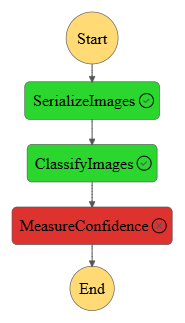

# Scones Unlimited: Serverless ML Image-Classification Workflow on AWS

An end-to-end, event-driven ML workflow on AWS that classifies delivery-vehicle images (**bicycle vs motorcycle**) for the fictional logistics company *Scones Unlimited*. It is built with **SageMaker, Lambda and Step Functions**, with **Model Monitor** capturing live inference data. Udacity AWS Machine Learning Engineer programme.

## Architecture

The Step Functions state machine (`Scones.asl.json`) chains three Lambda functions (`lambda.py`):

1. **Serialize image data:** downloads the image from S3 and base64-encodes it.
2. **Classify:** sends the image to the SageMaker image-classification endpoint and returns the class probabilities.
3. **Filter low-confidence inferences:** fails the execution if no class reaches the **0.67 confidence threshold**, so uncertain predictions never reach downstream systems.

## Pipeline
1. **ETL:** extract CIFAR-100, keep the bicycle and motorcycle classes, transform them into PNGs and load them to S3.
2. **Train:** the SageMaker built-in image-classification algorithm (2 classes, 30 epochs).
3. **Deploy:** a SageMaker endpoint with **Data Capture** enabled for Model Monitor.
4. **Orchestrate:** Step Functions plus Lambda, tested with sample images (`test/`).
5. **Monitor:** captured inference records (`captured_data/*.jsonl`) are visualised to track confidence over time.

## Repository contents
| Path | Description |
|------|-------------|
| `starter.ipynb` | Main notebook: ETL, training, deployment, monitoring |
| `lambda.py` | Source of the three Lambda functions |
| `Scones.asl.json` | Step Functions state-machine definition |
| `execution-detail.json` | A sample workflow execution |
| `captured_data/` | Model Monitor data-capture records |
| `test/` | Sample test images |
| `stepfunctions_graph*.png`, `file.png` | Workflow screenshots |

## Run it
Run `starter.ipynb` in SageMaker Studio (`Python 3 (Data Science)` kernel, `ml.t3.medium`). Then create the three Lambdas from `lambda.py`, update `ENDPOINT` in the classifier Lambda, and import `Scones.asl.json` into Step Functions. **Delete the endpoint afterwards** to avoid charges.

## Tech stack
AWS SageMaker · Lambda · Step Functions · S3 · Model Monitor · Python · boto3
